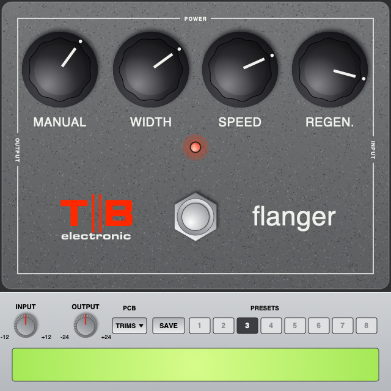

# TB 117 Flanger (2026 Mac)

TB 117 Flanger for current Macs: **CLAP, VST3 and AU**, universal (Apple Silicon and Intel),
**macOS 11 and later**. Use it in Reaper, FL Studio, Logic, GarageBand, Tape16 and other hosts.

The sound and panel are the same as the Mac OS X 10.8.5 VST build
([TB-117-Mountain-Lion](https://github.com/tonybuzzcock/TB-117-Mountain-Lion)). The DSP code is the
same, and the test suite checks that the plugin's output matches it sample for sample. It's a model
of the original MXR M117 Flanger (the SAD1024 version), built from the schematic ("MXR Flanger
Original", drawing by Stellan Lehrberg, in `Docs/`) and tuned against the user's own pedal.
Personal, non-commercial use.

## Install

GitHub → Actions → latest run → Artifacts → `TB-117-mac`, unzip, then follow `INSTALL.txt`.
In short:

- `TB 117 Flanger.vst3` → `VST3/`
- `TB 117 Flanger.component` → `Components/`
- `TB 117 Flanger.clap` → `CLAP/`

These folders are in `/Library/Audio/Plug-Ins/` (the main Library) or `~/Library/Audio/Plug-Ins/`
(your user Library). Use whichever one your other plugins are in. Apple hasn't notarised the
plugins, so run the short Terminal lines in `INSTALL.txt` for the folder you used. Then rescan
plugins in your DAW.

## Controls

| Name | Control | Range |
|------|---------|-------|
| Manual | the delay with Width at 0 | 0 – 10 (about 2.9 ms down to 0.5 ms) |
| Width | from the Manual setting to the full LFO sweep | 0 – 10 (full: about 0.6 – 4.3 ms) |
| Speed | the LFO rate | 0.08 – 8.9 Hz |
| Regen | regeneration | 0 – 10 (a steady ring at 2 o'clock, takes off from 3 o'clock) |
| Effect In/Out | the footswitch; the red LED lights with the effect in | In / Out |
| Input, Output | *plugin only*: level into the unit (1.0 = 1 V), output trim | ±12 dB, ±24 dB |
| Bias Trim | PCB trimpot (5K): SAD1024 bias. Centred = most headroom; off-centre, one side clips first | 0 – 10, default 5 |
| Level Trim | PCB trimpot (22K): wet level, and how hard Regen drives | 0 – 10, default 7.5 |
| Clock Trim | PCB trimpot (500K): shifts the whole delay range | 0 – 10, default 5 |

Defaults: every knob at noon, as MXR suggest. In stereo, each side runs through its own copy of the
circuit with the same settings; a mono source is processed once.

## The panel

640 × 640, laid out like the pedal: a battleship-grey hammertone face with the thin white line,
four black fluted knobs (MANUAL, WIDTH, SPEED, REGEN.), the red LED, the chrome stomp switch, the
TB electronic logo (with "electronic" in white) and "flanger". The strip along the bottom has
Input, Output, the **TRIMS** button, presets and the readout.

Drag a knob up or down to turn it (hold Shift for fine control). Double-click to reset it, or use
the scroll wheel. Click the stomp switch to switch the effect in or out. Click **TRIMS** to drop
the circuit board down over the face with its three trimpots; click again to put it away.

**Presets:** click SAVE, then a slot 1–8. Click a saved slot to recall it. The presets are kept in
`~/Library/Application Support/TB/TB 117 Flanger/Presets.txt` and shared by all three formats.

## Build

GitHub Actions (`.github/workflows/build.yml`) builds universal binaries on macOS, checks that all
three are arm64 + x86_64 with a macOS 11.0 minimum, ad-hoc signs them, and runs the CLAP host test,
the panel test, auval, clap-validator and pluginval (VST3 and AU). It runs on the Intel runner by
default; run it on Apple Silicon with
`gh workflow run build.yml -f runner=macos-15`.

Locally (macOS or Linux): `cmake -B build && cmake --build build`, then `build/preset_test`,
`build/flanger_test renders` and `build/clap_host_test "build/plugins/TB 117 Flanger.clap"`.
clap-wrapper v0.17.0 (MIT) and the SDKs it uses are downloaded at configure time.
